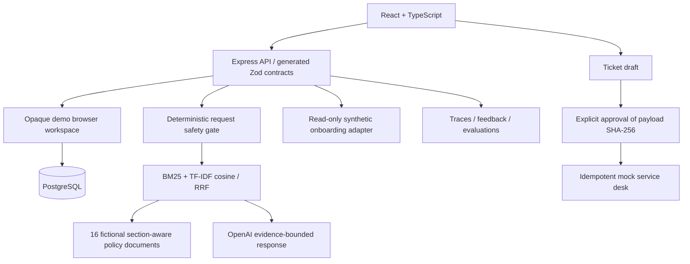

# CampusDesk AI

**An evidence-grounded university service-desk agent with synthetic onboarding checks and human-approved ticket submission.**

Built as an AI Agent Builder portfolio project. CampusDesk demonstrates retrieval, workflow safety, API contracts, persistence, evaluation, and observability—not just a chat interface.

> **Demo only.** Every policy, person, onboarding record, and enterprise integration is fictional. This is not university guidance and must not receive real student, employee, research, or credential data. The persona switch is **not authentication**.

## What works

- Ask university policy questions and inspect numbered source passages.
- Compare hybrid retrieval (BM25 + TF-IDF cosine via reciprocal rank fusion) with a vector-only baseline.
- Check Alex or Jordan's synthetic TA onboarding checklist.
- Create and edit support-ticket drafts; review the exact payload before approval.
- Reject approvals for changed drafts; simulate connector failure and safely retry.
- Persist conversations, feedback, tickets, audit events, and evaluation results in PostgreSQL.
- View real session latency, token usage, abstentions, feedback, and execution traces.
- Run 50 versioned retrieval and deterministic-control cases through the Evaluations page.

## Two-minute demo

1. Open the assistant as **Alex Morgan**.
2. Ask: **“I’m a new teaching assistant. What do I need before I can access the LMS?”**
3. Inspect the citations and execution trace. Alex has incomplete FERPA training and no course roster assignment.
4. Choose **Draft ticket**. Review/edit the content; saving a draft does not submit it.
5. On Tickets, review the payload and confirm approval. Optionally simulate a connector failure, then retry.
6. Ask **“Show Jordan onboarding status.”** The privacy gate should refuse. Use the explicit demo persona switch to explore Jordan's separate synthetic workspace instead.
7. Open Evaluations and run the checks. Open Observability to inspect actual activity.

## Architecture



### Deliberate scope decisions

This first implementation uses the existing **TypeScript / Express / React** workspace rather than adding a separate Python service. The workflow is explicit application code rather than LangGraph or CrewAI.

**The vectors are TF-IDF text vectors, not neural semantic embeddings.** BM25 and cosine retrieval run over the small bundled corpus in-process. There is no pgvector index, learned reranker, external SIS/LMS/HRIS, or live ticketing integration. PostgreSQL stores application state, not a semantic search index. These limitations are intentional and must not be misrepresented in interviews.

The AI provider supplies answer generation, not embeddings. When no AI provider is configured, the app explicitly returns **extractive source passages** instead of pretending an LLM ran. Provider failures return an error; they are not silently replaced with a successful AI answer.

## Repository map

| Location | Purpose |
|---|---|
| `artifacts/campusdesk` | React interface and all five application pages |
| `artifacts/api-server/src/routes/campus.ts` | Validated API endpoints |
| `artifacts/api-server/src/lib/campus` | Corpus, retrieval, agent, state, tickets, evaluations, tests |
| `lib/api-spec/openapi.yaml` | Source-of-truth API contract |
| `lib/api-client-react` / `lib/api-zod` | Generated client hooks and validation schemas |
| `lib/db` | PostgreSQL connection and schema |
| `docs/SECURITY.md` | Trust boundaries and production limitations |
| `docs/EVALUATION.md` | Metrics, reproduction, and interpretation |

## Development

Prerequisites: Node.js 24+, pnpm 10+, and PostgreSQL. No container runtime is required.

```bash
pnpm install
# Set DATABASE_URL in your environment; never commit its value.
pnpm --filter @workspace/db run push
pnpm --filter @workspace/api-spec run codegen
```

Start each service in its own terminal:

```bash
PORT=5000 pnpm --filter @workspace/api-server run dev
PORT=5173 BASE_PATH=/ pnpm --filter @workspace/campusdesk run dev
```

Use a reverse proxy that routes `/api` to port 5000 and `/` to port 5173. If your development environment already provides path-based service routing, use that configuration instead.

For generated answers, set these server-side environment variables for an OpenAI-compatible provider:

- `AI_INTEGRATIONS_OPENAI_BASE_URL`: your provider's API base URL.
- `AI_INTEGRATIONS_OPENAI_API_KEY`: your provider's API credential.

These are the environment-variable names expected by this application. Use a provider that supports the configured `gpt-5.4-mini` model, or update the model selection for your provider. Model usage is billed by your chosen provider. Never commit credentials or expose them through `VITE_` variables. Without both variables, the app uses clearly labeled extractive mode.

```bash
pnpm run typecheck
pnpm --filter @workspace/api-server run test
```

After changing the API spec, rerun codegen before using updated types.

## Evaluation and evidence

The Evaluations page starts empty: click **Run evaluation** to generate real results. The suite contains 32 retrieval questions and 18 deterministic safety/workflow checks. It reports recall@5 for each retrieval strategy, not answer accuracy or citation entailment. No improvement percentage is claimed in advance.

Unit tests are included for retrieval, safety gates, stale approval, simulated failure, and idempotent resubmission. See [evaluation documentation](docs/EVALUATION.md) for what these tests do **not** prove.

No demo video, production SSO integration, security certification, or live enterprise connector is claimed. Record your own demo after reviewing the app.

## Production readiness

This is a bounded portfolio MVP, not a production university deployment. Before real institutional use, add institution-managed SSO, role/resource authorization, retention/deletion controls, robust DLP, distributed rate limiting, secret management, production monitoring, connector reconciliation, semantic retrieval, and human-reviewed answer evaluations.

See [security limitations](docs/SECURITY.md). Do not load real educational records into this demo.
